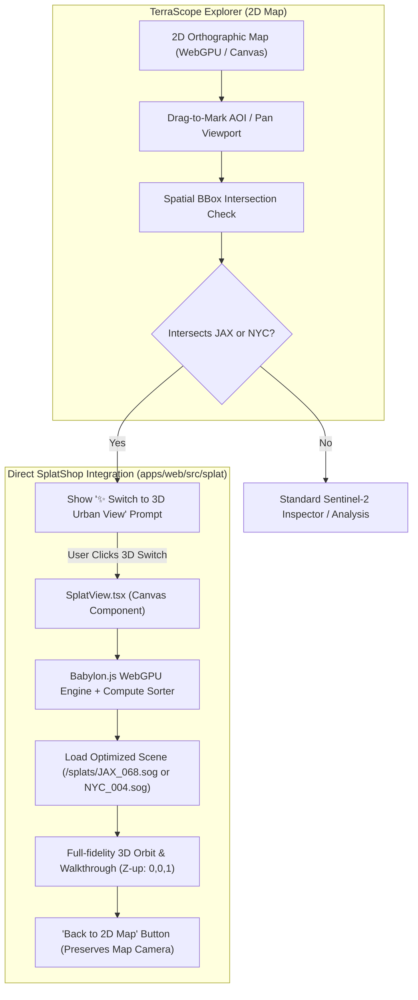

# TerraScope + Skyfall-GS Integration

> Current runtime: SuperSplat app/controls with native PlayCanvas GSplat rendering.
> Section 10 records the replacement; preceding sections preserve the original plan and implementation history.

## 1. Executive Summary & Objectives

This document details the direct integration of **Skyfall-GS** pre-trained urban scenes (Jacksonville, FL and New York City, NY) and the **SplatShop WebGPU 3D Gaussian Splatting engine** directly inside **TerraScope**.

* **No iframes**: SplatShop's Babylon.js WebGPU engine, radix sort compute pipelines, and `@playcanvas/splat-transform` loaders are embedded directly inside TerraScope as a native React view component (`SplatView.tsx`), mirroring `GlobeView.tsx`.
* **Explorer Mode "Drag-to-Mark" Area of Interest (AOI)**: Users can navigate the 2D Sentinel-2 map, drag-to-mark a rectangular bounding box over an area, or frame a city.
* **Instant Spatial Detection**: When the marked area or current viewport intersects one of the pre-trained Skyfall-GS locations (`JAX` or `NYC`), an interactive 3D chip appears allowing the user to seamlessly switch into the immersive 3D Gaussian Splat view.

---

## 2. System Architecture



---

## 3. The Two Pre-trained Locations (Skyfall-GS)

Skyfall-GS provides pre-trained models on Hugging Face (`jayinnn/Skyfall-GS-ply`). We anchor them to precise geographic footprints:

| Location | Scene ID | Bounding Box `[West, South, East, North]` | Center `(Lon, Lat)` | Model Format |
| :--- | :--- | :--- | :--- | :--- |
| **Jacksonville, FL** | `JAX_068` | `[-81.670, 30.315, -81.645, 30.335]` | `(-81.658, 30.325)` | `.sog` / `.ply` |
| **New York City, NY** | `NYC_004` | `[-74.015, 40.705, -73.990, 40.720]` | `(-74.006, 40.7128)` | `.sog` / `.ply` |

---

## 4. Direct SplatShop Integration (Engine & Components)

### 4.1 Dependency Setup
In `TerraScope/apps/web/package.json`, add SplatShop's core dependencies:
```bash
cd /home/narinder/Documents/TerraScope/apps/web
npm install @babylonjs/core@^8.20.0 @playcanvas/splat-transform@2.3.1
```

### 4.2 Module Porting to `apps/web/src/splat/`
Port the runtime modules from `/media/narinder/Data1/Projects/SplatShop/src/` into TerraScope:
* `apps/web/src/splat/engine/`:
  * `asset-loader.ts` & `file-handler.ts` (Handles `.sog`, `.ply`, `.splat`, `.spz`).
  * `splat/SplatCloud.ts` (Babylon mesh representing the splats).
  * `rendering/` (WebGPU compute radix sort, tile binning, quad instance shaders).
  * `io/` (Mapped file system & binary readers).

### 4.3 Native React Component: `SplatView.tsx`
Create `apps/web/src/splat/SplatView.tsx` to handle the canvas lifecycle alongside `GlobeView.tsx`:

```tsx
import { useEffect, useRef, useState } from 'react';
import { Engine } from '@babylonjs/core/Engines/engine';
import { WebGPUEngine } from '@babylonjs/core/Engines/webgpuEngine';
import { Scene } from '@babylonjs/core/scene';
import { ArcRotateCamera } from '@babylonjs/core/Cameras/arcRotateCamera';
import { Vector3 } from '@babylonjs/core/Maths/math.vector';
import type { SplatSceneMeta } from '../data/splatScenes';

export interface SplatViewProps {
  active: boolean;
  sceneMeta: SplatSceneMeta;
  onClose: () => void;
}

export function SplatView({ active, sceneMeta, onClose }: SplatViewProps): React.JSX.Element {
  const canvasRef = useRef<HTMLCanvasElement>(null);
  const engineRef = useRef<WebGPUEngine | Engine | null>(null);
  const [loading, setLoading] = useState(true);
  const [progress, setProgress] = useState(0);

  useEffect(() => {
    const canvas = canvasRef.current;
    if (!active || !canvas) return;

    let disposed = false;

    async function initEngine() {
      // 1. Initialise WebGPU engine with WebGL fallback
      let engine: WebGPUEngine | Engine;
      if (await WebGPUEngine.IsSupportedAsync) {
        const webgpu = new WebGPUEngine(canvas, { antialias: false, powerPreference: 'high-performance' });
        await webgpu.initAsync();
        engine = webgpu;
      } else {
        engine = new Engine(canvas, true);
      }
      if (disposed) { engine.dispose(); return; }
      engineRef.current = engine;

      // 2. Setup Babylon scene and camera (Z-up for Skyfall-GS)
      const scene = new Scene(engine);
      const camera = new ArcRotateCamera(
        'SplatCamera',
        -Math.PI / 2,
        Math.PI / 3,
        250,
        Vector3.Zero(),
        scene
      );
      camera.upVector = new Vector3(0, 0, 1); // Z-up
      camera.attachControl(canvas, true);

      // 3. Load Splat using SplatShop's AssetLoader
      // (Loads sceneMeta.splatUrl with progress callback)
      setLoading(false);

      engine.runRenderLoop(() => {
        scene.render();
      });
    }

    void initEngine();

    return () => {
      disposed = true;
      engineRef.current?.dispose();
      engineRef.current = null;
    };
  }, [active, sceneMeta]);

  return (
    <div className={`splat-view-direct${active ? ' active' : ''}`} aria-hidden={!active}>
      <canvas ref={canvasRef} className="splat-canvas" />
      <div className="splat-controls-overlay">
        <div className="splat-title">
          <h3>{sceneMeta.name}</h3>
          <span className="badge">Skyfall-GS 3D Gaussian Splat</span>
        </div>
        <button type="button" className="primary" onClick={onClose}>
          ← Back to Map
        </button>
      </div>
      {loading && <div className="splat-spinner">Loading 3D Gaussian Splats...</div>}
    </div>
  );
}
```

---

## 5. Drag-to-Mark AOI in Explorer Mode

### 5.1 Scene Definition Registry (`apps/web/src/data/splatScenes.ts`)
```typescript
export interface SplatSceneMeta {
  id: string;
  name: string;
  city: 'JAX' | 'NYC';
  bounds: { west: number; south: number; east: number; north: number };
  center: { lon: number; lat: number };
  splatUrl: string;
  upVector: [number, number, number];
}

export const SKYFALL_SCENES: SplatSceneMeta[] = [
  {
    id: 'JAX_068',
    name: 'Jacksonville Downtown (JAX 068)',
    city: 'JAX',
    bounds: { west: -81.670, south: 30.315, east: -81.645, north: 30.335 },
    center: { lon: -81.658, lat: 30.325 },
    splatUrl: '/splats/JAX_068.sog',
    upVector: [0, 0, 1],
  },
  {
    id: 'NYC_004',
    name: 'New York City (NYC 004)',
    city: 'NYC',
    bounds: { west: -74.015, south: 40.705, east: -73.990, north: 40.720 },
    center: { lon: -74.006, lat: 40.7128 },
    splatUrl: '/splats/NYC_004.sog',
    upVector: [0, 0, 1],
  },
];

export function findIntersectingScene(bbox: {
  west: number;
  south: number;
  east: number;
  north: number;
}): SplatSceneMeta | undefined {
  return SKYFALL_SCENES.find((scene) => (
    scene.bounds.west <= bbox.east &&
    scene.bounds.east >= bbox.west &&
    scene.bounds.south <= bbox.north &&
    scene.bounds.north >= bbox.south
  ));
}
```

### 5.2 Drag-to-Mark Marquee Interaction (`apps/web/src/App.tsx`)
1. **Marquee Box State**: Add `aoiSelection: { start: {x,y}, current: {x,y}, active: boolean }`.
2. **Shift + Drag or Mode Toggle**:
   * Holding `Shift` + Left Drag (or toggling a **"Mark Area"** button on the toolbar) draws a visual bounding box rectangle over the canvas.
   * On pointer up, the screen box is converted to Lon/Lat bounds using `MapCamera.screenToLonLat()`.
3. **Trigger**:
   * If `findIntersectingScene(markedBBox)` finds a scene, activate the prompt:
     `"Jacksonville 3D Scene detected! [Switch to 3D View]"`
   * Clicking it sets `viewMode = '3d_splat'`, rendering `SplatView` with `JAX_068`.

---

## 6. Model Asset Compression Pipeline

To ensure sub-2-second load times inside TerraScope:
1. Download fused PLYs from Hugging Face:
   * `JAX_068_fused.ply`
   * `NYC_004_fused.ply`
2. Run `@playcanvas/splat-transform` (already installed in SplatShop):
   ```bash
   npx @playcanvas/splat-transform JAX_068_fused.ply /home/narinder/Documents/TerraScope/apps/web/public/splats/JAX_068.sog
   npx @playcanvas/splat-transform NYC_004_fused.ply /home/narinder/Documents/TerraScope/apps/web/public/splats/NYC_004.sog
   ```
3. Vite will serve these directly from `/splats/*.sog` with streamable binary headers.

---

## 7. Implementation Checklist

- [x] **Step 1: Dependencies** — Install `@babylonjs/core` and `@playcanvas/splat-transform` in `TerraScope/apps/web`.
- [x] **Step 2: Engine Port** — Port SplatShop's `AssetLoader.ts`, compute radix sorter, and `SplatCloud.ts` into `TerraScope/apps/web/src/splat/`.
- [x] **Step 3: Component Creation** — Build `SplatView.tsx` with Babylon WebGPU canvas lifecycle and Z-up orbital camera.
- [x] **Step 4: Spatial Metadata** — Create `apps/web/src/data/splatScenes.ts` with JAX and NYC boundaries.
- [x] **Step 5: Drag & Mark UI** — Add the Marquee AOI drag handler in `App.tsx` and place-search shortcuts.
- [x] **Step 6: Asset Conversion** — Compress and place `JAX_068.sog` and `NYC_004.sog` into `apps/web/public/splats/`.
- [x] **Step 7: Verification** — Run `npm run dev` in TerraScope, select Jacksonville/NYC, and test the smooth transition to the direct 3D Gaussian Splat viewer.


## 8. Implementation & Verification (2026-10-20)

Implemented as a native React canvas view. The local SplatShop runtime was
ported from commit `879080b1d41686ce2b4b1c83152364a87f1ac2a7`;
`apps/web/src/splat/PORT.md` records the adaptations. The heavy renderer is
loaded on demand. The map remains mounted while the splat viewer is active.

- Explorer supports Shift + left drag, a Mark Area toggle, Escape cancellation,
  clearing selections, viewport intersection detection and both city shortcuts.
- The viewer uses Z-up orbit/pan/zoom controls, bounds-based framing, reset,
  download progress, retryable errors, abortable downloads, ResizeObserver
  resizing and disposal on exit. WebGL uses expanded SOG data when WebGPU is
  unavailable; WebGPU uses SplatShop's packed rendering and compute sorting.
- Real published inputs are `JAX_068_final.ply` and `NYC_004_final.ply`, rather
  than the `_fused.ply` names in the initial proposal. The converted assets
  retain 2,309,268 and 2,344,147 splats, respectively. Source/output hashes and
  byte sizes are in `apps/web/public/splats/manifest.json`.
- `npm run prepare:skyfall` downloads and converts missing assets. Use
  `SKYFALL_GPU=1` to select an adapter after checking `npx splat-transform --list-gpus`.
- `npm run typecheck`, all 126 unit tests, `npm run build`, and the existing
  `npm run test:gpu` browser parity check passed.
- `npm run test:splat` verifies both actual model files in headless Chrome with
  native Vulkan, including both marking gestures, rendering, reset, map camera
  preservation and closing during loading. It uses a 200,000-splat render budget
  for the smoke check while decoding the complete assets. Set `SPLAT_TEST_URL`
  for a server on another port and `SPLAT_SCREENSHOTS` to export screenshots.
  A separate small-model check verified WebGL2 fallback with WebGPU disabled.

The full SOG files are 31,722,474 and 31,334,762 bytes. They work with Vite's
local/static server, but exceed Cloudflare Workers Static Assets' [25 MiB
per-file limit](https://developers.cloudflare.com/workers/platform/limits/#static-assets).
For Cloudflare deployment, upload them to object storage, set
`VITE_SPLAT_BASE_URL` at build time, and exclude local SOGs from the static asset
upload. No cloud resources were changed or deployed by this implementation.
The sub-two-second load target has not been established by a deployment
benchmark. Geographic discovery uses the plan's supplied approximate footprints.

SwiftShader exhibited multi-device loss when both map and splat devices were
alive; native Vulkan rendered both cities without runtime errors. Runtime GPU
loss now produces a retryable error in the viewer.


## 9. Satellite ground layer

The splat viewer now includes an EOX satellite map underneath each model. It
shares the 3D camera, so orbit, pan, zoom and reset apply to both layers. A
Satellite map checkbox controls visibility. A failed map request shows a
non-blocking Retry map action while the splat model remains usable.

The ground mosaic uses the same Sentinel-2 cloudless 2024 tile service as the
Explorer. Tile requests are limited to four concurrent downloads, a 20-second
load timeout and a maximum 1792 × 1792 texture for the registered scenes.
Textures, GPU buffers and pending requests are released on exit or reload.
The ground is drawn before Gaussian blending on WebGPU; WebGL uses an unlit
textured ground mesh. Map attribution is displayed while the layer is visible.

The registry footprint is fitted to the model's XY extent, with the ground
slightly below its minimum Z. This provides approximate spatial context;
matching individual buildings requires authoritative scene position, scale and
heading metadata. The UI explicitly labels the alignment as approximate.

Validation: 129 unit tests, typecheck and production build pass. Browser tests
verify satellite ground loading, visibility toggling, both city models, reset,
returning to the map and cancellation with native WebGPU. Screenshots were
visually checked for both cities. `SPLAT_FORCE_WEBGL=1` exercises the fallback renderer. The earlier
SplatShop render-budget query option is superseded by the native renderer in section 10.

## 10. SuperSplat replacement (2026-10-20)

The earlier SplatShop/Babylon implementation described above has been replaced
by a native PlayCanvas viewer using SuperSplat's local app and pointer-control
modules. Reference: `/home/narinder/Documents/supersplat` (3.5.2), commit
`f2a1b4975b4766e0ee0c95e63c2737dc2ecb6e5b`; engine version: `playcanvas@2.23.0`.
The native PlayCanvas GSplat asset/component loader renders the existing SOG
files. The SuperSplat editor UI and its editor-specific renderer are not
embedded. No iframe or separate editor server is used.

Babylon, the ported SplatShop runtime, compute shaders and WASM workers have
been removed. Asset compression remains on the original splat-transform 2.3.1
as a development tool. City discovery, AOI marking, both converted city models,
map-camera preservation, download cancellation, retry, reset, satellite-map
visibility and approximate ground placement remain available.

The model and ground mesh share a root rotation from Z-up to the Y-up frame
used by SuperSplat controls. CSS controls the canvas dimensions; its backing
resolution follows the displayed size and capped device-pixel ratio.

Source provenance, adaptations and license: `apps/web/src/splat/PORT.md`.


Replacement validation: all 130 unit tests, typecheck, production build and the
existing real-browser GPU parity suite passed. The city-view browser checks
passed on native WebGPU and software WebGL2 with both complete SOG assets,
satellite ground loading/toggling, canvas resizing, reset, preserved 2D camera
and cancellation. Both backend screenshots were visually reviewed. The browser
checks now use the native renderer's full flat scene files rather than the old
SplatShop `splatBudget` smoke-test override.
